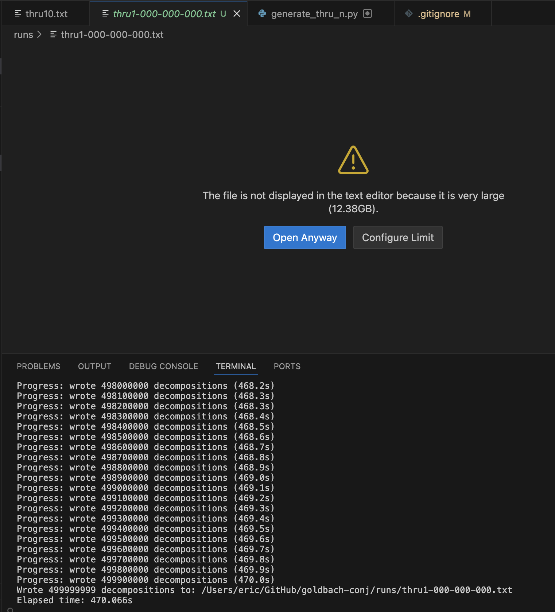

A reproducible computational check of the Goldbach Conjecture for even numbers.
The generator can run through 1 billion, while the checked-in text artifact
covers 4 through 1 million. A finite computation is evidence about that range,
not a mathematical proof for every even number.

In my own words: The Goldbach Conjecture states that all even numbers after 2 can be created by adding only 2 prime numbers together.

```
Elapsed time: 0.224s
Sample decompositions (up to 10):
4 = 2 + 2
6 = 3 + 3
8 = 3 + 5
10 = 3 + 7
12 = 5 + 7
14 = 3 + 11
16 = 3 + 13
18 = 5 + 13
20 = 3 + 17
22 = 3 + 19
```

Generate a bounded run and its provenance manifest with:

```
python3 generate_thru_n.py \
  --max-n 1000000 \
  --output runs/thru1-000-000.txt \
  --manifest runs/thru1-000-000.json
python3 run_manifest.py verify runs/thru1-000-000.json
```

The manifest records the exact artifact digest, declared range, record count,
generator/checker source digests, and reproduction command. It is a provenance
check; it does not replace mathematical validation of each decomposition.
